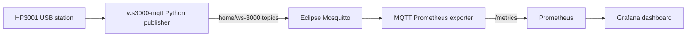

# Home weather dashboard

Graph temperature and relative humidity from a MISOL HP3001 / WS-3000 USB
weather station. The station can report up to eight channels; this dashboard
will show your five populated channels automatically. The graphs label them
**living room**, **yellow room**, **master room**, **Blue room**, and **Outside**
for channels 1–5 respectively.

The dashboard shows indoor readings (channels 1–4) and Outside readings
(channel 5) in separate temperature and relative humidity graphs.
Each graph uses a five-minute moving average to soften one-reading jumps.
Grafana refreshes every minute, matching the station's polling interval;
the raw readings remain in Prometheus.

The publisher is the [ws3000-mqtt project](https://github.com/hindenbugbite/ws3000-mqtt)
at commit `7658aa32193106bb289f76a969af0272bf35ed27`, copied into
`station/upstream/` with its GPL-3.0 license. Its Python dependencies and the
exporter's dependencies are installed with [uv](https://docs.astral.sh/uv/)
using `uv.lock`. It polls the USB station every 60 seconds and publishes each
value to a separate MQTT topic. The exporter turns those topics into labelled
Prometheus metrics; it converts Fahrenheit readings to Celsius when required.

## Start

Requirements: Linux host, Docker with Compose, and the station connected by
USB. Docker must be able to access `/dev/bus/usb`. The containers run on the
same Docker network; only Grafana and Prometheus have host ports. Mosquitto
allows anonymous access within that network and has no host port.

1. Copy `.env.example` to `.env` and set a strong `GRAFANA_ADMIN_PASSWORD`.
2. Run `docker compose up -d --build`.
3. Open <http://localhost:3000> and sign in as `admin` with that password.
   The **Home weather station** dashboard is provisioned automatically.

Grafana and Prometheus listen on localhost by default. To open Grafana from
another device on your LAN, set `GRAFANA_BIND_ADDRESS=0.0.0.0` in `.env` and
use the Docker host's IP address on port 3000. Restrict access to your trusted
network. Prometheus is available locally at <http://localhost:9090>.

## Verify and troubleshoot

Run `docker compose ps` to check container health, then
`docker compose logs -f station exporter` to see station and MQTT activity.
The station should publish a new reading about once per minute. In Prometheus,
query `ws3000_temperature_celsius` or `ws3000_humidity_percent` and check
that channels 1–5 appear. The exporter also publishes
`ws3000_last_update_timestamp_seconds`; the dashboard omits readings older
than three minutes.

If the station cannot open USB, check that `/dev/bus/usb` exists on the host
and that no other program is holding the device. The station container runs as
root so it can access the USB bus; no host udev rule is needed for this setup.
The exporter skips temperatures until it receives the station's `units` topic,
which is published with each poll. The graph may take one poll to populate
after startup.

Prometheus retains 90 days of samples in the `prometheus_data` volume. Grafana
settings live in `grafana_data`. `docker compose down` keeps both volumes.
